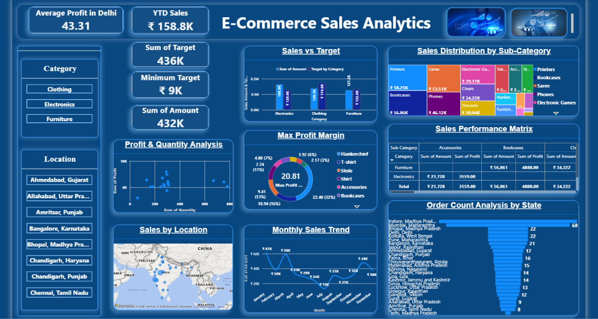

# E-Commerce Sales Analytics | Power BI Assignment 2

## 📊 Project Overview

This project was completed as part of **Power BI Assignment 2 – DAX Calculations and Data Visualization**, assigned by my mentor.

The project focuses on analyzing e-commerce sales performance using Microsoft Power BI. It includes DAX calculations, KPI cards, sales target analysis, profit analysis, monthly sales trends, geographic sales analysis, and interactive slicers.

## 🖥️ Dashboard Preview

## 🎯 Project Objectives

- Analyze overall sales and profit performance.
- Compare actual sales with sales targets across categories.
- Analyze monthly sales trends.
- Evaluate profit margins across sub-categories.
- Explore sales geographically using a map.
- Analyze order counts across locations.
- Create interactive reports using Category and Location slicers.

## 🛠️ Tools & Technologies

- **Microsoft Power BI Desktop**
- **DAX (Data Analysis Expressions)**
- **Power Query / Data Transformation**
- **Data Visualization**
- **Data Modeling**

## 📈 Key Dashboard Features

### KPI Cards
- Average Profit in Delhi
- Year-to-Date (YTD) Sales
- Total Sales Target
- Minimum Target
- Total Sales Amount

### Data Visualizations
- Sales vs Target
- Sales Distribution by Sub-Category
- Max Profit Margin
- Profit & Quantity Analysis
- Sales Performance Matrix
- Sales by Location
- Monthly Sales Trend
- Order Count Analysis by State

### Interactive Filters
- Category slicer
- Location slicer

## 🧮 DAX Calculations

The assignment includes calculated columns and measures such as:

- **Category Type** – Combines Category and Sub-Category.
- **Revenue per Order** – Calculates Amount multiplied by Quantity.
- **Sales Category** – Classifies sales as Above Average or Below Average.
- **Order Count** – Counts distinct Order IDs.
- **Average Profit in Delhi** – Calculates average profit for Delhi-related records.
- **YTD Sales** – Calculates year-to-date sales.
- **Target by Category** – Supports comparison of sales and targets by category.
- **Minimum Target** – Returns the minimum target value.

## 📁 Repository Files

| File | Description |
|---|---|
| `E-Commerce Sales Analysis - Assignment 2.pbix` | Power BI project file |
| `DAX, Data Visualization_Observations.pdf` | Step-by-step assignment observations |
| `DAX_Data_Visualization_ScreenShot.pdf` | Assignment screenshots |
| `dashboard.png` | Final dashboard preview |

## 📚 What I Learned

Through this assignment, I practised creating DAX calculated columns and measures, designing KPI cards, building different visualizations, comparing sales with targets, and developing an interactive Power BI dashboard.

This project helped me strengthen my practical skills in **Power BI, DAX, data modeling, and business data visualization**.

## 👨‍💻 Project Information

- **Project:** E-Commerce Sales Analytics
- **Assignment:** Power BI Assignment 2 – DAX Calculations and Data Visualization
- **Purpose:** Mentor-assigned learning project
- **Tool:** Microsoft Power BI Desktop

---

*This project was developed for learning and skill development as part of my Data Analytics upskilling journey.*
